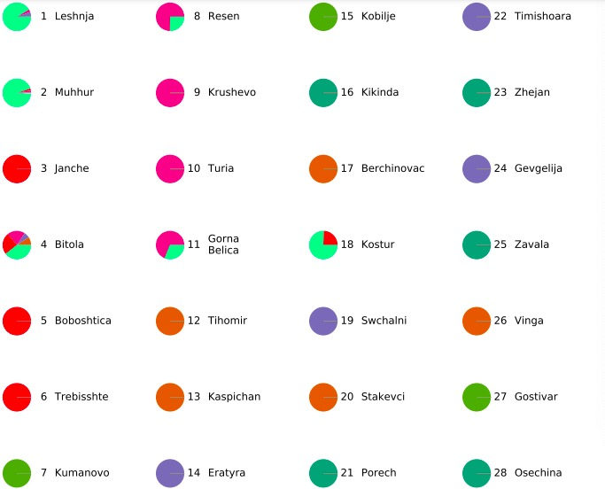

# Pie plots

Pie plots show how often each object is assigned to each cluster in the posterior, 
for example, how often a language is assigned to each area. The figure below shows pie plots from an `sBayes` 
language analysis with seven clusters.

    
     
    
Pie plot for an sBayes analysis with seven clusters.

Instead of pies, each panel can show the distribution of each cluster's membership
across the posterior samples as a KDE or histogram (`chart_type`). By default, only an
object's main cluster keeps its color and the others are greyed out. Panels can also
show each object's confounder group (e.g. its family) beneath the name, or be arranged
in one row per cluster (`group_by_cluster`).

#### Further reading:
- [How to set up pie plots in **`config_plot.yaml`**](../configuration/config_plot.md#pie-plots-plotspies)
- [How to change the appearance of pie plots in **`config_style.yaml`**](../configuration/config_style.md#pie-plots-pies)
- [How to render pie plots](../quickstart.md#pie-plots)